# Brain Storm Quality

## Глобальный конфиг
Что описывает конфиг:  
1. names - имена для полей, содержащих необходимую информацию
    1. Внутренние имена теста
        1. point_name - техническое поле, не рекомендуется менять
        2. score_name - указания имени поля с оценкой асессора, именовать в соответствии с правилами названий sampler'а
        3. theme_name - указание имени поля с тематикой запроса, именовать в соответствии с правилами названий sampler'а
        4. task_idea_name - техническое поле, не рекомендуется менять
        5. idea_idea_name - техническое поле, не рекомендуется менять
        6. task_name - указания имени поля с постановкой задачи, именовать в соответствии с правилами названий sampler'а
        7. ideas_name - указания имени поля с ответами модели на поставленную задачу, именовать в соответствии с правилами названий sampler'а
    2. Имена датасета
        1. raw_task_name - название поля с постановкой задачи, используемое в датасете
        2. raw_ideas_name - название поля с ответами модели на поставленную задачу, используемое в датасете
        3. raw_theme_name - название поля с тематикой запроса, используемое в датасете
        4. raw_score_name - название поля с оценкой асессора, используемое в датасете
2. palettes - цветовую палитру для отрисовки распределений брейнштормов 
    1. drawer_palette - представляет собой список цветов, не короче, чем максимум из количества различных оценок асессоров и тем запросов
3. nlp - параметры для обработки естественного языка
    1. language - язык датасета
    2. stopword_path - путь до файла со стоп-словами
    3. re_ideas_splitter - регулярное выражение, которое позволит разделить ответы модели друг от друга
## Конфиг задач
Что описывает конфиг:  
1. runs - список словарей со следующими ключами
    1. embedders_name - название эмбеддера (Например 'e5' или 'sbert')
    2. function_pairs - список из пар названий мер близости, реализованных в SimFunCollection.py для подсчета близости идей к задаче и разнообразия идей соответственно.
    3. use_text_cleaner - *ОПЦИОНАЛЬНО* принимает значение 'True' или 'False'. Поднятие флага вызовет предобработку переданных текстов и ответов модели: очистка текста от стоп слов и символов пунктуации и стемминг токенов. Пропуск поля приравнен к 'False'
    4. use_lemmatization - *ОПЦИОНАЛЬНО* принимает значение 'True' или 'False'. Поднятие флага вызовет при поднятом use_text_cleaner изменит проведение предобработки: вместо стемминга будет проведена лемматизация текста. Пропуск поля приравнен к 'False'
    5. normalize - *ОПЦИОНАЛЬНО* принимает значение 'True' или 'False'. Поднятие флага вызовет нормализацию эмбеддингов внутри SBERTEmbedder.py. Пропуск поля приравнен к 'False'
## Датасеты и необходимые данные
Существует четыре планируемых применения теста: 
 
1. Сценарий I: Переданы ответы модели и постановки задач, оценки асессоров и тематики задач - создаст табличку со средними отклонениями авто-оценок от оценок асессоров, создаст пару цветных графиков на сессию, показывающих распределение текстов по плоскости метрики с цветным обозначением оценки асессора и распределение текстов по плоскости метрики с цветным обозначением тематики запроса
2. Сценарий II: Переданы ответы модели и постановки задач, оценки асессоров - создаст табличку со средними отклонениями авто-оценок от оценок асессоров, создаст по одному цветному графику на сессию, показывающему распределение текстов по плоскости метрики с цветным обозначением оценки асессора
3. Сценарий III: Переданы ответы модели и постановки задач, тематики задач - создаст по одному цветному графику на сессию, показывающему распределение текстов по плоскости метрики с цветным обозначением тематики запроса
4. Сценарий IV: Переданы только ответы модели и постановки задач - создаст по одному одноцветному графику на сессию, показывающему распределение текстов по плоскости метрики